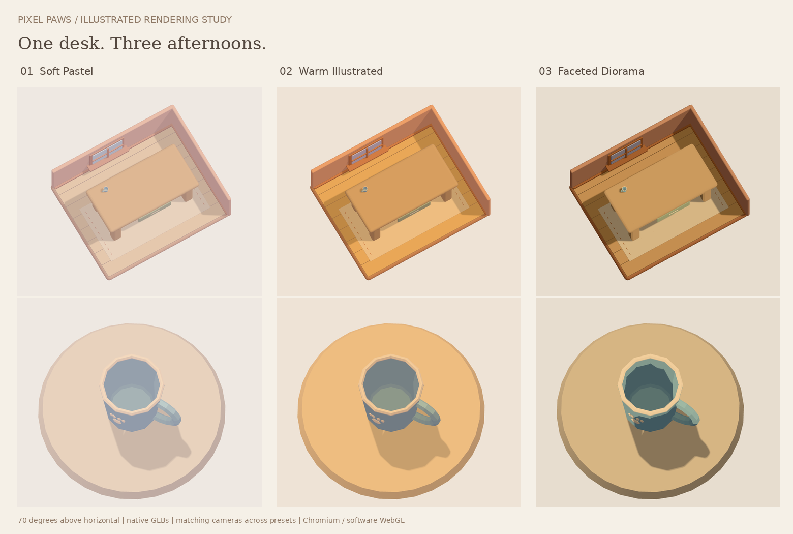

# Illustrated rendering experiment

Throwaway visual exploration for Pixel Paws. Branch:
`experiment/illustrated-rendering`, based on `feature/study-desk` at
`e7d7942c67559263421dba57123b11b20260705b`.

## Try it

With Node 24, from the repository root:

```sh
npm ci
node experiments/illustrated-rendering/serve.mjs
```

Open http://localhost:4174. Select **Soft Pastel**, **Warm Illustrated**, or
**Faceted Diorama**. **Mug detail** provides a close-up without scaling or rotating
the model. **Save image** downloads the current canvas as PNG. The footer's
**Download standalone preview** saves the entire preview, including both GLBs and
Three.js, as one offline HTML file to share with teammates.

To build without serving:

```sh
node experiments/illustrated-rendering/build.mjs
# Or specify a destination directory:
node experiments/illustrated-rendering/build.mjs work/illustrated-review
```

The default file is `work/illustrated-rendering/index.html`. Double-click it in a
modern WebGL browser; no server, CDN, network or game installation is needed.
The `work/` directory is already ignored. Generated HTML is not committed.
`PORT=4175` overrides the preview server's default port.

## Captured comparison



Portrait screenshots at 390×844 CSS pixels, captured at 2× pixel ratio:

- [Soft Pastel](screenshots/soft-pastel-portrait.png)
- [Warm Illustrated](screenshots/warm-illustrated-portrait.png)
- [Faceted Diorama](screenshots/faceted-diorama-portrait.png)

## Visual choices

The supplied illustration guides warm wood, peach walls, lavender accents,
simple planes and a small diorama composition. Its pixels are not sampled and no
reference image path is assumed. The stage, window and stitched mat are temporary
viewer geometry, not exported assets.

| Preset | Rendering |
| --- | --- |
| Soft Pastel | Lambert shading; 25% pale paint wash; high ambient fill; low key light |
| Warm Illustrated | Lambert shading; 12% apricot wash; honey key light; lavender bounce |
| Faceted Diorama | Four-band toon shading; 4% wash; stronger separation of existing baked facets |

All presets use sRGB output, neutral tone mapping, zero specular lighting, and
blurred variance shadow maps. Original linear vertex colors remain the basis of
the material. Color washes are shader-only and materials are viewer-owned.
There is no geometry decimation or normal rebaking; the GLBs already have facets.
Rendering happens on changes and resize, without a continuous animation loop.
Pixel ratio is capped at two and the shared shadow map is 1024×1024.

The camera is orthographic at **70° above horizontal**, with a **150° azimuth**
for the full stage and 30° for the mug detail so its +Z paw faces the viewer.
Projection and placements stay identical between presets. Framing adapts to
aspect ratio with margin for the full stage. The desk sits on the mat at
Y=0.027; the mug sits on its top at `[0.58, 0.777, 0.27]`. Both retain unit scale,
native pivots and identity rotation. The mug's realistic size makes it small in
the full composition; the detail view is a camera zoom.

## Isolation and asset integrity

Only this directory is added relative to `feature/study-desk`. No application,
physics, touch control, manifest, generator, skill, dependency or production
build file is changed. The viewer reads the existing GLBs through the existing
read-only loader's legacy-pivot adapter. Its build embeds their exact bytes:

| Asset | SHA-256 |
| --- | --- |
| `src/assets/models/mug.glb` | `e13d5667b6688c7a74e3c81a427b92fec4f49f79a27660c067eee6237c34b79e` |
| `src/assets/models/desk.glb` | `29f5ef241bc0bca43fb0baad9444623955549a6afe7807c1c4be81958e92c78e` |

Existing dependencies are reused: Three.js 0.186.1 and esbuild 0.25.12.
No dependency or lockfile changes are needed.

## Verification

Repository checks: `npm test` (7 test files passing), `npm run build` (including
asset validation), `npm run assets:reproduce:mug` and
`npm run assets:reproduce:desk` (two isolated runs each match approved bytes).

Browser review covers 360×800, 390×844 and 1440×1000; all presets, both views,
distinct rendered output, PNG downloads, URL preset persistence, offline
standalone execution and no console errors or failed requests. The offline check
loads the standalone HTML into an offline blank document because this managed
Chromium blocks `file://` navigation. Evidence is captured
with Chromium using SwiftShader software WebGL at 2× pixel ratio. Actual mobile
GPU performance and final art approval remain untested.

This is not a production integration. No pull request, merge or deployment is
part of this experiment.
